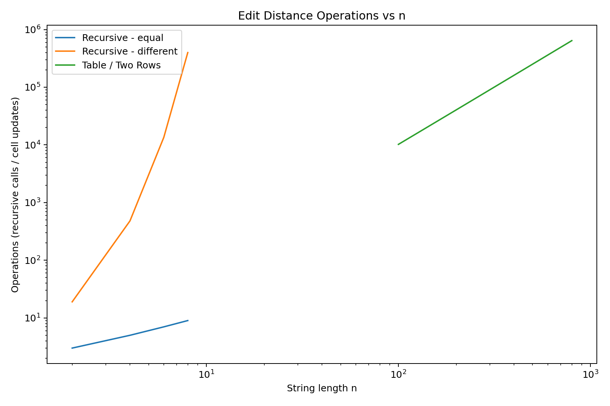
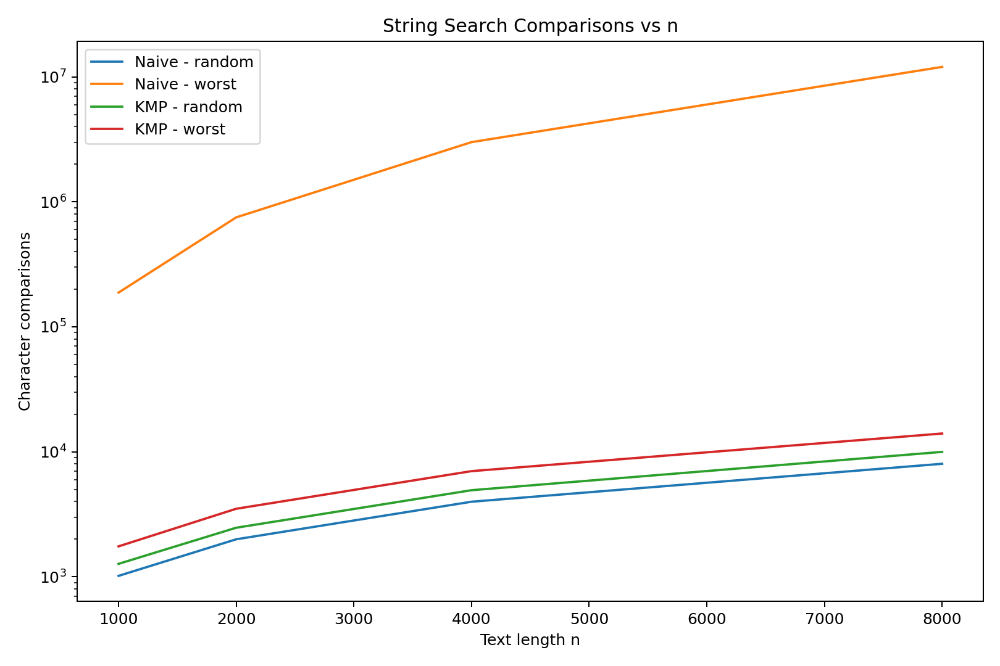
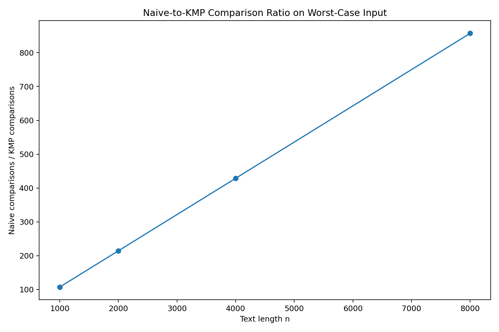

# Assignment 4 - Dynamic Programming and String Algorithms

## Experiment Design Card

| Field | Edit Distance | String Search |
|---|---|---|
| Question | How does recursive Edit Distance grow compared with the two dynamic programming versions? | How does KMP compare with Naive Search on random and worst-case input? |
| Sizes | Recursive: n = 2, 4, 6, 8. Table and Two Rows: n = 100, 200, 400, 800. | Text size n = 1000, 2000, 4000, 8000. Pattern length = n / 4. |
| Inputs | Equal strings as an easy case and completely different strings as a hard case for recursion. | Random text/pattern and worst case: text contains only `A`, while the pattern contains many `A` characters followed by `B`. |
| Metrics | Recursive calls, DP cell updates, and median execution time from 5 runs. | Character comparisons and median execution time from 5 runs. |
| Prediction | Recursive Edit Distance should grow very quickly on different strings. Table and Two Rows should show approximately quadratic growth and similar operation counts. | Naive Search should work well on random input but become much worse on repetitive worst-case input. KMP should remain close to linear growth. |
| Plots | Edit Distance operations vs n using logarithmic axes. | Search comparisons vs n and Naive/KMP comparison ratio vs n. |

A fixed random seed of `42` was used to make the generated inputs reproducible. Each case was executed five times, and median execution time was used when comparing timing results.

---

## Edit Distance Results

Three Edit Distance implementations were tested: Recursive, full DP Table, and Two Rows DP.

For equal strings, the recursive algorithm required only a small number of calls because matching characters allow it to continue with only one recursive branch. The number of calls was 3, 5, 7, and 9 for sizes 2, 4, 6, and 8.

The situation was very different for completely different strings. Recursive calls increased from 19 at `n = 2` to 481 at `n = 4`, 13,483 at `n = 6`, and 398,593 at `n = 8`.

The two dynamic programming versions had predictable growth. At `n = 100`, both computed 10,201 DP states. At `n = 800`, both computed 641,601 states.

### Plot 1 - Edit Distance Operations



**Takeaway:** Recursive Edit Distance grows very quickly on different strings, while both dynamic programming versions compute a predictable quadratic number of states.

### Prediction vs Result - Edit Distance

My prediction was correct. The recursive version was efficient on equal strings because it followed only one recursive path, but it became much more expensive when every character was different.

The Table and Two Rows versions showed approximately quadratic growth because both calculate each DP state once. They also produced the same number of cell updates. The main advantage of Two Rows is therefore memory usage rather than a different asymptotic number of calculations.

---

## String Search Results

Naive Search and KMP were tested on random input and a specially designed worst-case input.

On random input, Naive Search usually found a mismatch quickly. At `n = 8000`, it made 8,016 character comparisons, while KMP made 9,981 search comparisons.

The difference became much larger on worst-case repetitive input. At `n = 1000`, Naive Search performed 187,750 comparisons while KMP performed 1,751. At `n = 8000`, Naive Search performed 12,002,000 comparisons while KMP performed only 14,001.

### Plot 2 - String Search Comparisons



**Takeaway:** Naive Search becomes much more expensive on repetitive worst-case input, while KMP keeps the number of comparisons close to linear growth.

### Plot 3 - Naive/KMP Ratio



The Naive/KMP comparison ratio on worst-case input was approximately:

| n | Naive / KMP |
|---:|---:|
| 1000 | 107x |
| 2000 | 214x |
| 4000 | 429x |
| 8000 | 857x |

**Takeaway:** The advantage of KMP increases with input size, reaching more than 850 times fewer comparisons than Naive Search at `n = 8000` on the tested worst-case input.

### Prediction vs Result - String Search

The result mostly matched my prediction. KMP performed much better than Naive Search on the repetitive worst-case input because it used the LPS information instead of restarting the comparison from the next position.

An interesting result was that Naive Search performed fewer comparisons than KMP on random input. This happens because random strings often produce an early mismatch, so Naive Search can stop after only one or a few comparisons. Therefore, KMP gives its biggest advantage when the input contains repeated prefixes or other difficult patterns.

---

## Execution Time

Execution time was measured with `System.nanoTime()` and every experiment was repeated five times. I used median time because individual measurements can change because of JVM warm-up and other system activity. For example, Recursive Edit Distance on different strings at `n = 8` had a median time of about 1.43 ms, while Naive Search on worst-case input at `n = 8000` had a median time of about 22.69 ms. Time was not used as the only evidence because operation counters are more stable and clearly show how the algorithms scale.

---

## Short Answers

### 1. Which input made string search slowest, and why?

The repetitive worst-case input made Naive Search the slowest. The text contained only `A` characters, while the pattern contained many `A` characters followed by `B`. Naive Search compared almost the whole pattern at every possible starting position before finding the mismatch at the end.

### 2. How large n could recursive Edit Distance handle, and what stopped it?

In my planned experiment, I tested the hard recursive case up to `n = 8`. At this size it already required 398,593 recursive calls, compared with only 13,483 calls at `n = 6`. The very fast growth in repeated recursive work was the reason I did not use the same large sizes as the dynamic programming versions.

### 3. What do we gain and lose with Two Rows compared with the full table?

Two Rows gives the same final Edit Distance while reducing extra memory from `O(n × m)` to `O(m)`. It still performs approximately the same number of DP state calculations and keeps the same `O(n × m)` time complexity. The disadvantage is that the complete DP table is not stored, so it is harder to reconstruct the full sequence of edit operations later.

### 4. If you had to choose one string search algorithm for the city platform, which would you choose and why?

I would choose KMP for the city platform. On normal random input, Naive Search can be simple and efficient, but its performance becomes much worse on repetitive or difficult patterns. KMP provides more predictable linear behavior and avoids repeatedly checking characters that were already matched.

---


## Project Information

### Project Structure

The project is organized into three main packages:

- `com.example.edit` - contains Recursive, Table, and Two Rows Edit Distance implementations.
- `com.example.search` - contains Naive Search and KMP.
- `com.example.benchmark` - contains the reproducible string generator and benchmark experiment.

JUnit 5 tests are located in `src/test/java`.

Experiment results are stored in:

`results/results.csv`

Generated plots are stored in:

`results/plots/`

---

## How to Build and Test

The project uses Maven and Java 25.

To run all JUnit tests:

```bash
mvn test
```

The tests check:

- Edit Distance reference values.
- Empty string cases.
- Equality of all three Edit Distance implementations on 100 random short inputs.
- Reference LPS arrays.
- Reference string search results.
- Overlapping matches.
- Empty pattern exception.
- Pattern longer than text.
- Equality of Naive Search and KMP on 100 random inputs.

---

## How to Run the Experiment

Run the `Benchmark` class:

```text
src/main/java/com/example/benchmark/Benchmark.java
```

The benchmark runs every experiment five times and writes the data to:

```text
results/results.csv
```

The CSV contains:

- algorithm
- input type
- n
- m
- run number
- execution time in milliseconds
- operation counter
- metric name

A fixed random seed of `42` is used so that the generated random data is reproducible.

---

## Git Information

Development was completed on the `main` branch.

The project uses small commits for the main implementation stages:

1. Recursive Edit Distance.
2. Dynamic Programming Edit Distance.
3. Naive and KMP String Search.
4. Tests and benchmark experiment.
5. Final report and plots.

The final version is marked with the Git tag:

```text
v1.0
```

---

## AI Use Acknowledgement

AI tools were used as assistance during the development of this assignment. They were used to help explain algorithm concepts, organize the experiment, review code structure, and prepare documentation. The implementations, experiments, test execution, results, and final project were reviewed and run by the student.


## Conclusion

This experiment showed why input design is important when comparing algorithms. Recursive Edit Distance can look efficient on equal strings but grows extremely quickly when characters are different, while dynamic programming avoids repeated subproblems.

For string searching, Naive Search works well when mismatches happen early, but its worst case becomes expensive as the text and pattern grow. KMP uses the LPS array to reuse information from previous comparisons and gives much more stable performance on difficult inputs. The counters and plots provided clearer evidence of algorithm growth than execution time alone.